<div align="center">


# Training Platform

### Course and training management for learners, trainers and admins

A Symfony web app where learners browse courses and enroll in scheduled sessions,<br>
trainers follow their sessions and students, and admins run the catalog. Branded **Forminy** in the UI.


[How it works](#how-it-works) &nbsp;·&nbsp; [Screenshots](#screenshots) &nbsp;·&nbsp; [Get started](#get-started) &nbsp;·&nbsp; [Reference](#reference) &nbsp;·&nbsp; [Team](#team)

</div>

---

## What is Training Platform?

**Why.** A training centre has to keep track of a lot: which courses exist, when each one runs, how many seats are left,
who signed up, and what trainers need to tell their groups. Spreadsheets and email threads get out of sync quickly.

**What.** A single web app with three kinds of users. **Learners** browse the catalog by category, open a course, and
enroll in (or leave) one of its dated sessions. **Trainers** see their sessions, the enrolled students, course materials
and enrollment charts, and post announcements to a session. **Admins** manage courses, sessions, users and categories,
look at reports, export CSV files and change site settings, including a maintenance mode.

**Result.** A working Symfony 7.2 application built as a team project by four classmates. It covers the full loop from
publishing a course to a learner seeing it in their schedule. Some parts are still prototypes; they are listed under
[Known gaps](#reference).

<p align="center">
  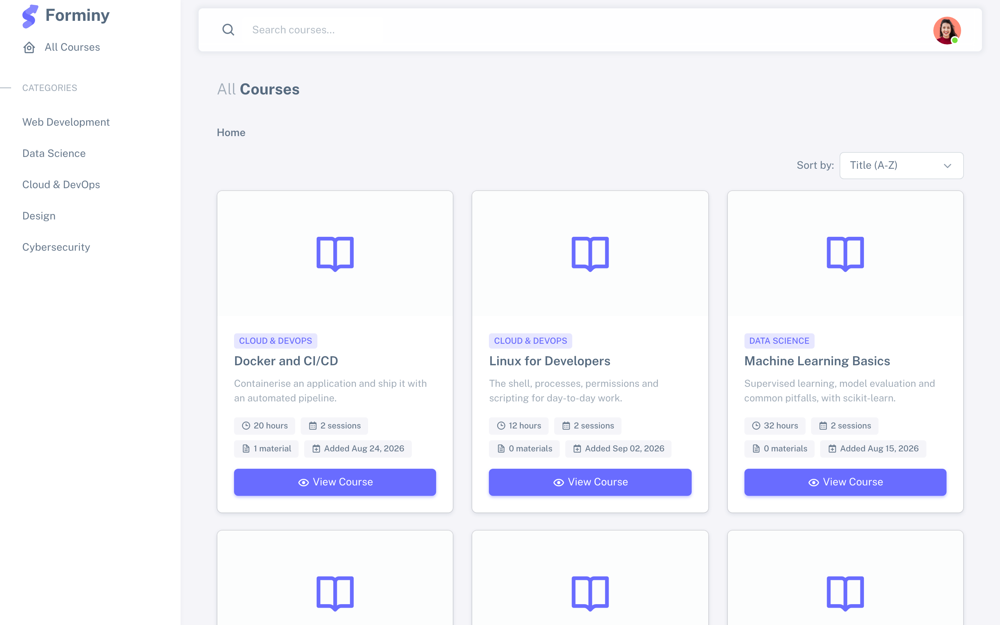
</p>

<sub>The home page is the course catalog: cards show category, duration in hours, number of sessions and materials. Demo data, seeded locally.</sub>

## What each role can do

| Role | Symfony role | Main pages | What they can do |
|---|---|---|---|
| Visitor | none | `/`, `/category/{id}`, `/course/{id}`, `/search` | Browse and search the catalog, sort by title or duration, view course details, download a syllabus |
| Learner | `ROLE_USER` | `/my-enrollments`, `/student/schedule`, `/student/announcements` | Enroll in and leave sessions, see upcoming and past sessions, read trainer announcements (unread count on the bell) |
| Trainer | `ROLE_INSTRUCTOR` | `/instructor/...` | Dashboard, sessions by status, students and their progress, upload course materials (documents), enrollment charts, post announcements to a session |
| Admin | `ROLE_ADMIN` | `/admin/...` | CRUD for courses (with image and PDF syllabus), sessions, users and categories; reports with CSV export; site settings and maintenance mode |

Every signed-in user also has a profile page (`/user/profile`) and account settings (`/user/settings`: change password, delete account).

## How it works

<!-- diagram:architecture -->
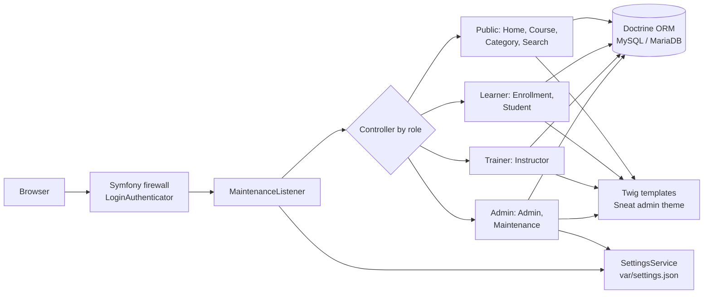
<!-- /diagram -->

<sub>Firewall = Symfony's security layer that checks who is signed in; ORM = object-relational mapper, which maps PHP classes to database tables; Twig = Symfony's template language; Sneat = the Bootstrap admin theme the pages are built on.</sub>

1. **Sign-in.** A form login (`LoginAuthenticator`) checks email and password with a CSRF token and an optional
   "remember me" cookie. New users register at `/register`, get `ROLE_USER` and are signed in straight away.
2. **Maintenance check.** On every request `MaintenanceListener` reads the settings. When maintenance mode is on,
   visitors get a 503 page; admins can still reach `/admin/...` pages and can bypass or switch the mode off.
3. **Role-based controllers.** `AdminController` requires `ROLE_ADMIN`, `InstructorController` requires `ROLE_INSTRUCTOR`,
   and enroll/unenroll require a signed-in user. There is no role hierarchy, so an admin is not automatically a trainer.
4. **Data.** Doctrine entities hold the catalog and activity (model below). Site settings are not in the database:
   `SettingsService` keeps them in `var/settings.json`.
5. **Pages.** Twig templates on the Sneat Bootstrap theme, with ApexCharts on the trainer analytics page and Chart.js on the admin reports page.

### Enrolling in a session

<!-- diagram:enroll -->
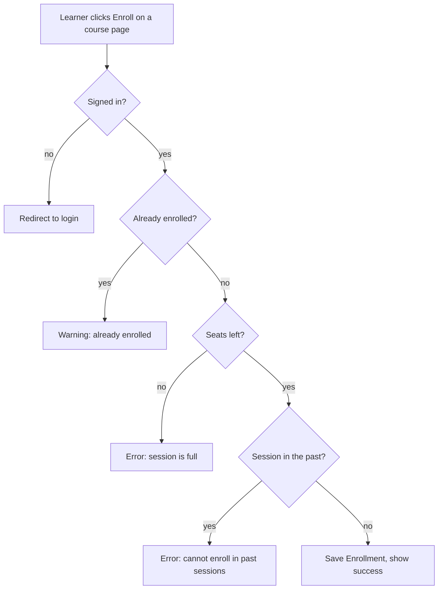
<!-- /diagram -->

<sub>Seats left = session capacity minus current enrollments. Leaving a session runs the same past-date check.</sub>

### Data model

<!-- diagram:model -->
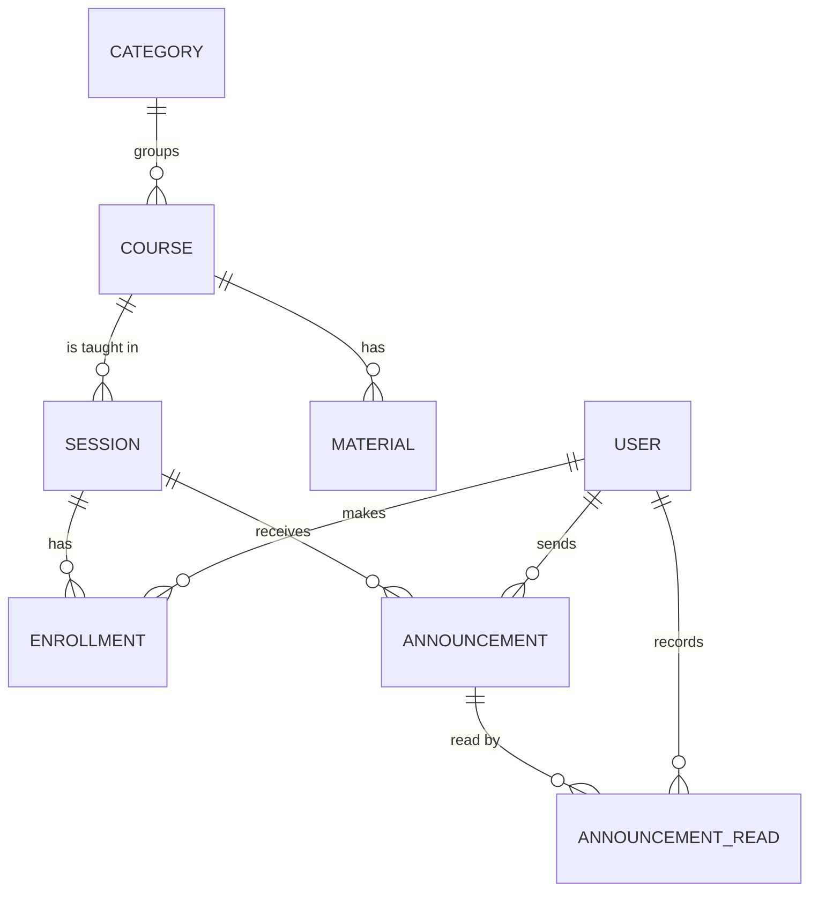
<!-- /diagram -->

<sub>A course has a title, description, duration in hours, optional image and PDF syllabus. A session has start and end dates, a time, capacity, location and type. `ANNOUNCEMENT_READ` marks which learner has read which announcement.</sub>

**Tech stack:** PHP 8.2+, Symfony 7.2 (security, forms, validator, mailer, messenger, AssetMapper with importmap, Stimulus and
Turbo), Doctrine ORM 3.3 with Doctrine Migrations, Twig, the Sneat Bootstrap admin theme, ApexCharts and Chart.js (from a CDN), and MySQL/MariaDB as the
target database. Dev tools: Symfony Maker, Doctrine Fixtures, Web Profiler, PHPUnit.

## Screenshots

All screenshots use demo data (made-up courses and users such as `learner@example.com`), seeded locally.

<table>
  <tr>
    <td width="50%">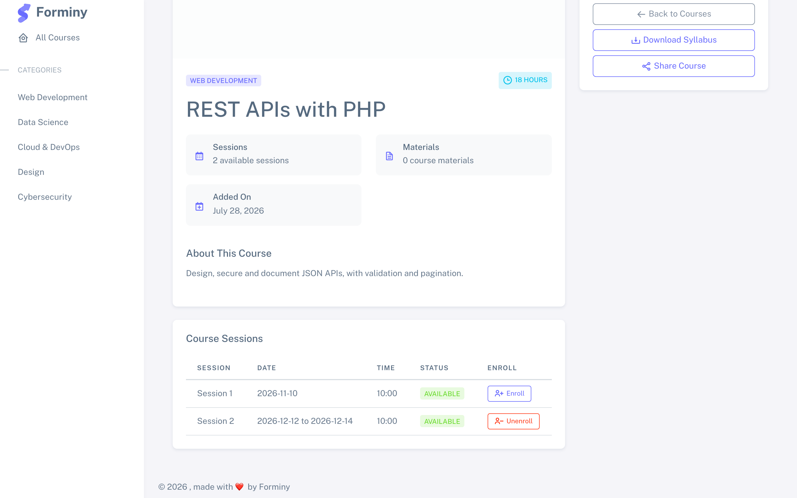<br><sub><b>Course detail.</b> Sessions with dates, status and Enroll / Unenroll for the signed-in learner.</sub></td>
    <td width="50%">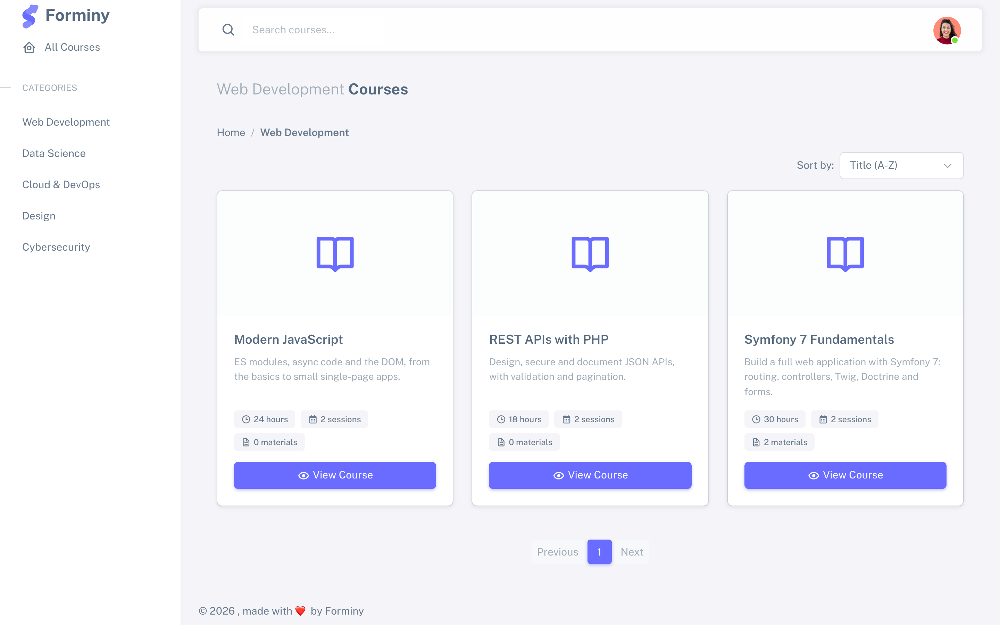<br><sub><b>Category view.</b> The catalog filtered by one category, with sorting and pagination.</sub></td>
  </tr>
  <tr>
    <td width="50%">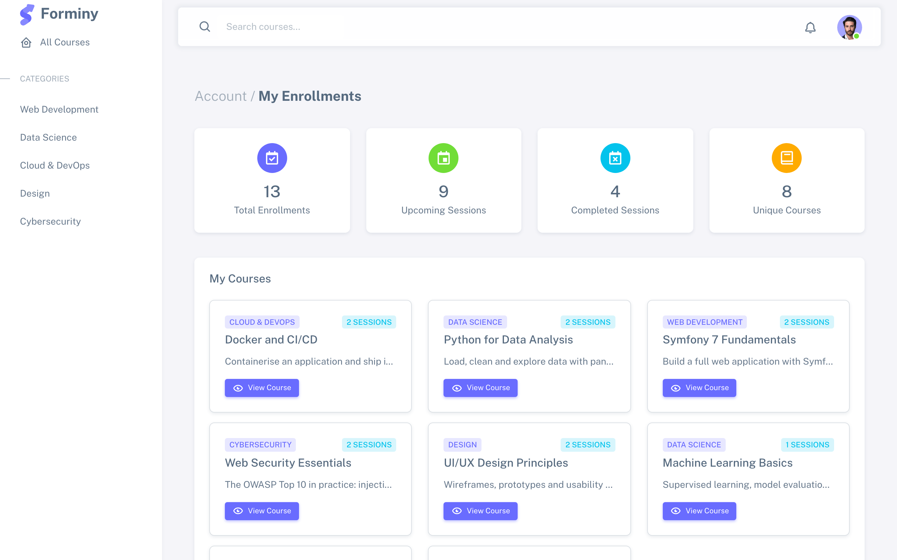<br><sub><b>My enrollments.</b> Totals for upcoming and completed sessions and the courses a learner joined.</sub></td>
    <td width="50%">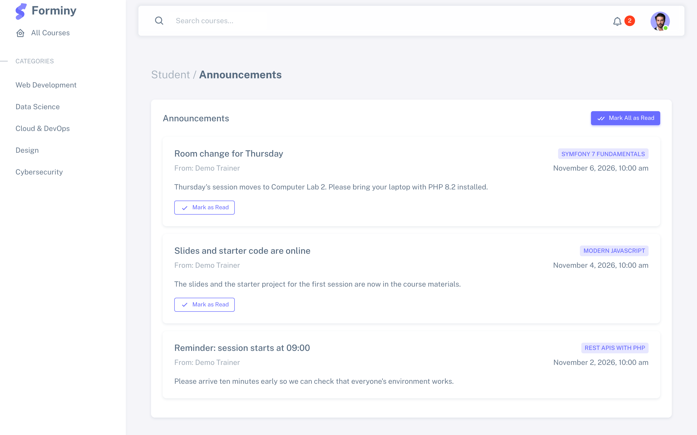<br><sub><b>Announcements.</b> Messages from trainers for the learner's sessions; the bell shows the unread count.</sub></td>
  </tr>
  <tr>
    <td width="50%">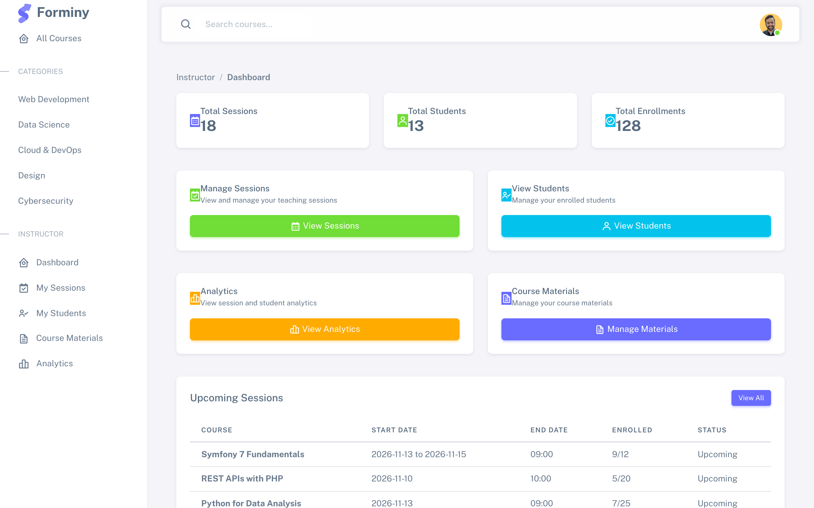<br><sub><b>Trainer dashboard.</b> Counts, shortcuts and the sessions starting in the next seven days.</sub></td>
    <td width="50%">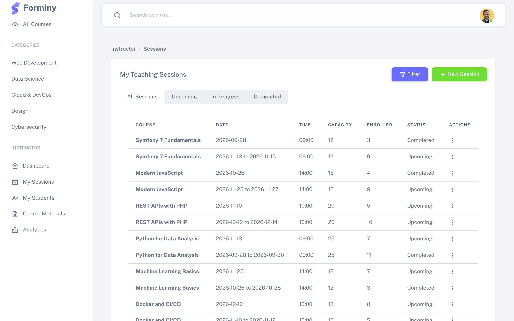<br><sub><b>Trainer sessions.</b> All, upcoming, in-progress and completed sessions with enrollment counts.</sub></td>
  </tr>
  <tr>
    <td width="50%">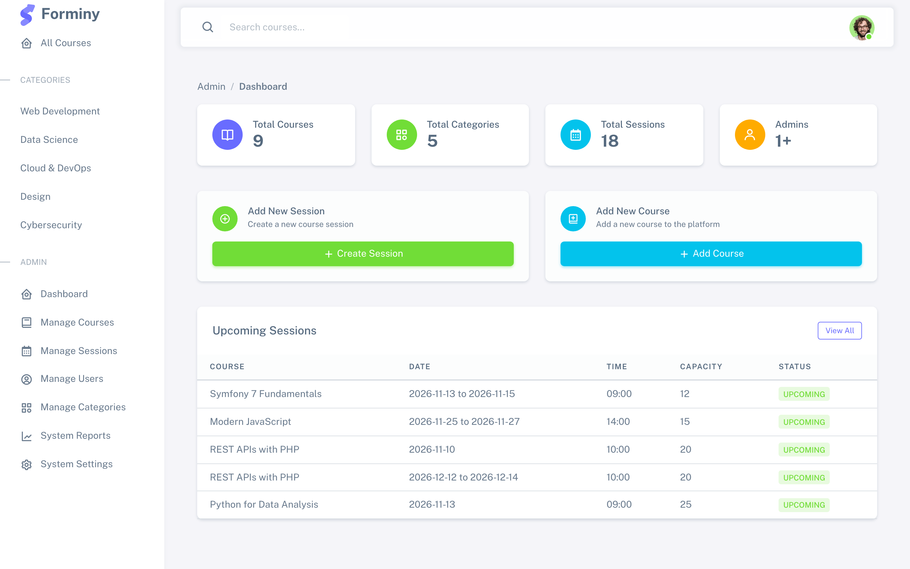<br><sub><b>Admin dashboard.</b> Totals, quick actions and upcoming sessions.</sub></td>
    <td width="50%">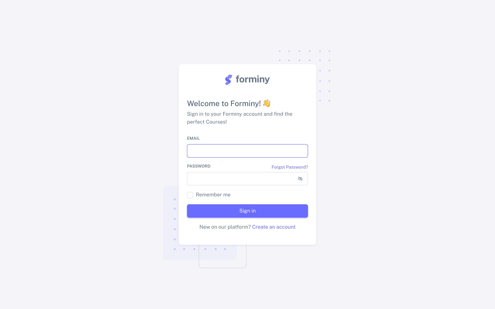<br><sub><b>Login.</b> Email and password, with "remember me" and a link to registration.</sub></td>
  </tr>
</table>

## Get started

You need PHP 8.2+ (with `pdo_mysql` or `pdo_sqlite`), Composer, and MySQL or MariaDB. The [Symfony CLI](https://symfony.com/download) is optional.

```sh
git clone https://github.com/Tayss1r/Training_Platform.git
cd Training_Platform
composer install                                  # also runs assets:install and importmap:install

# point Doctrine at your database in .env.local (gitignored), for example:
echo 'DATABASE_URL="mysql://root:@127.0.0.1:3306/training_platform?serverVersion=10.4.32-MariaDB&charset=utf8mb4"' > .env.local

php bin/console doctrine:database:create
php bin/console doctrine:migrations:migrate
php bin/console doctrine:fixtures:load            # optional: sample categories, courses, sessions and one user per role
php bin/console app:generate-sessions --count=5   # optional: more sessions for existing courses

symfony server:start                              # or: php -S localhost:8000 -t public
```

**Quick try without MySQL.** The migrations are written for MySQL/MariaDB, so for a throwaway SQLite database create the
schema directly instead of migrating:

```sh
echo 'DATABASE_URL="sqlite:///%kernel.project_dir%/var/data.db"' > .env.local
php bin/console doctrine:schema:create
php bin/console doctrine:fixtures:load -n
```

**Theme files for the login and register pages.** These two templates load the theme from `public/assets/...`, which is
gitignored, so on a fresh clone they show without styles. Copying the committed theme files fixes that locally:

```sh
mkdir -p public/assets/img
cp -R public/vendor public/css public/js public/assets/
cp -R public/img/avatars public/img/favicon public/assets/img/
```

```text
src/
  Controller/      Home, Course, Category, Search, Enrollment, Student, Instructor, Admin, Maintenance,
                   Registration, Security, User, Help
  Entity/          Category, Course, Session, Enrollment, Material, Announcement, AnnouncementRead, User, Setting
  Repository/      Doctrine repositories (announcement queries for unread counts live here)
  Form/            Course, Session, Category, User, Registration, Profile, PasswordChange, AccountDelete
  Service/         SettingsService (var/settings.json), ReportService (stats, CSV exports)
  EventListener/   MaintenanceListener
  Security/        LoginAuthenticator, EmailVerifier
  Command/         app:generate-sessions, app:update-session-data
  DataFixtures/    sample categories, courses, sessions and users
  Twig/            AppExtension (exposes site settings to templates)
templates/         Twig pages per area: home, course, category, enrollment, student, instructor, admin, user, help
migrations/        Doctrine migrations (MySQL/MariaDB)
public/            front controller, Sneat theme (vendor/), CSS, JS, images, uploaded syllabuses and materials
assets/            AssetMapper entry points and Stimulus controllers
config/            Symfony configuration (security, doctrine, messenger, mailer, ...)
training_platform.sql   early MariaDB dump (April 2025), kept for reference
```

## Reference

<details>
<summary><b>Environment variables</b></summary>

Set these in `.env.local` (gitignored). The committed `.env` holds development defaults only.

| Variable | Default in `.env` | Purpose |
|---|---|---|
| `APP_ENV` | `dev` | Symfony environment |
| `APP_SECRET` | set | Used for CSRF tokens and the remember-me cookie; set your own outside development |
| `DATABASE_URL` | local MariaDB `training_platform` | Doctrine connection |
| `MESSENGER_TRANSPORT_DSN` | `doctrine://default?auto_setup=0` | Queue for async messages (mail is routed through it) |
| `MAILER_DSN` | `null://null` | Mail transport; the default discards mail |

`.env.dev` and `.env.test` hold the secrets and settings for those environments.

</details>

<details>
<summary><b>Routes</b></summary>

**Public**

| Path | Name | What it does |
|---|---|---|
| `/` | `home` | Course catalog, 9 per page, sort by title or duration |
| `/category/{id}` | `category_courses` | Courses in one category |
| `/course/{id}` | `course_show` | Course detail and its sessions with remaining seats |
| `/course/{id}/syllabus` | `course_download_syllabus` | Download the PDF syllabus |
| `/search?q=` | `app_search` | Search course title and description |
| `/login`, `/logout`, `/register` | `app_login`, `app_logout`, `app_register` | Authentication |
| `/help`, `/help/contact` | `help_center`, `help_contact` | Help pages |

**Signed-in users**

| Path | Name | What it does |
|---|---|---|
| `/session/{id}/enroll` | `session_enroll` | Enroll (checks duplicates, capacity, past date) |
| `/session/{id}/unenroll` | `session_unenroll` | Leave a future session |
| `/my-enrollments` | `my_enrollments` | Enrollment totals and courses |
| `/student/schedule` | `student_schedule` | Next five upcoming sessions and today's sessions |
| `/student/announcements` | `student_announcements` | Announcements for enrolled sessions |
| `/student/announcements/{id}/read` (POST) | `student_announcement_read` | Mark one as read (JSON) |
| `/student/announcements/count` | `student_announcements_count` | Unread count (JSON) |
| `/user/profile`, `/user/settings` | `app_user_profile`, `app_user_settings` | Profile, password change, account deletion |

**Trainers** (`ROLE_INSTRUCTOR`, prefix `/instructor`)

| Path | What it does |
|---|---|
| `/`, `/sessions`, `/students`, `/analytics`, `/materials` | Dashboard, session list, student list, charts, materials |
| `/sessions/new`, `/sessions/{id}/edit`, `/sessions/{id}/delete` (POST) | Create, edit and delete sessions (JSON responses) |
| `/sessions/{id}`, `/sessions/{id}/students`, `/sessions/{id}/progress` | Session details, its students and progress |
| `/sessions/{id}/announcement` (POST) | Post an announcement to everyone enrolled |
| `/sessions/filter`, `/students/filter` (POST) | Filter lists (JSON) |
| `/students/{id}` and `/courses`, `/sessions`, `/progress` under it | One student's details |
| `/materials/create`, `/materials/{id}/edit`, `/materials/{id}/delete` (POST) | Upload and manage documents in `public/uploads/materials` |

**Admins** (`ROLE_ADMIN`, prefix `/admin`)

| Path | What it does |
|---|---|
| `/admin` | Dashboard |
| `/admin/courses`, `/new`, `/{id}/edit`, `/{id}/delete` | Courses, with image (max 1 MB) and PDF syllabus upload |
| `/admin/sessions`, `/new`, `/{id}/edit`, `/{id}/delete` | Sessions, filter by category and course |
| `/admin/users`, `/{id}/edit`, `/{id}/delete` | Users and their roles (Student, Instructor, Admin) |
| `/admin/categories`, `/{id}/edit`, `/{id}/delete` | Categories (a category with courses cannot be deleted) |
| `/admin/reports` | Totals, users by role, monthly activity chart, system health |
| `/admin/reports/export/users`, `/courses`, `/system-log` | CSV exports and a plain-text system log |
| `/admin/settings` | General, email, security, appearance (logo, favicon) and maintenance settings |
| `/admin/settings/clear-cache`, `/admin/settings/backup` | Clear the cache; save settings as JSON in `var/backups/` |
| `/admin/toggle-maintenance/{state}`, `/admin/bypass-maintenance`, `/admin/end-bypass`, `/admin/disable-maintenance` | Maintenance mode controls |

</details>

<details>
<summary><b>Site settings and maintenance mode</b></summary>

`SettingsService` stores settings as JSON in `var/settings.json` and creates defaults on first use, grouped as:

- **general:** site name (`Forminy`), description, admin email, timezone, date format
- **email:** SMTP host, port, user, password, encryption, sender
- **security:** password rules, session timeout, login attempts, two-factor flag
- **appearance:** theme, primary colour, logo, favicon
- **maintenance:** on/off and the message shown

When maintenance mode is on, every page except login and logout returns a 503 page with the message. Signed-in admins can
still open `/admin/...` pages, and can set a session bypass to browse the rest of the site.

</details>

<details>
<summary><b>Console commands</b></summary>

```sh
php bin/console app:generate-sessions --count=3   # add sample sessions to every existing course
php bin/console app:update-session-data           # fix sessions whose end date is before their start date
php bin/console doctrine:fixtures:load            # reload sample data (wipes the database)
php bin/console make:migration                    # after changing an entity
php bin/console doctrine:migrations:migrate
```

</details>

<details>
<summary><b>Security</b></summary>

- Form login with CSRF protection and a 7-day remember-me cookie.
- Passwords hashed with Symfony's `auto` hasher (bcrypt in the admin user form).
- Access by role on controllers: `ROLE_ADMIN` for admin and maintenance pages, `ROLE_INSTRUCTOR` for trainer pages, any
  signed-in user for enrollments. Delete actions for users and categories check a CSRF token.

</details>

<details>
<summary><b>Known gaps</b></summary>

Found while reading the code; useful for the next round of work.

- **Trainers see everything.** There is no link between a trainer and their courses yet, so trainer pages list all courses
  and sessions (the controller comments say so).
- **Placeholder content.** The "Student Engagement" table on the trainer analytics page is static sample data.
- **No email is sent.** Registration signs the user in without a confirmation email (`EmailVerifier` exists but is not
  called), and the "send email" option on announcements is stored but no mail goes out.
- **Course images.** Uploads are saved to `public/assets/img/courses`, while course cards load from `public/uploads/courses`,
  so uploaded images do not show yet.
- **`/student/dashboard`** renders a template that does not exist and returns an error; the learner pages that work are
  listed in the routes table.
- **No automated tests yet.** PHPUnit is configured (`php bin/phpunit`) but `tests/` only holds the bootstrap file.
- **`training_platform.sql`** is an early snapshot from April 2025 and predates later migrations; use the migrations for a new database.

</details>

## Team

Built as a team project by four classmates:

| GitHub | Role |
|---|---|
| [Tayss1r](https://github.com/Tayss1r) | Project lead |
| [AhmedMelliti1](https://github.com/AhmedMelliti1) | Web developer |
| [Ahmed-mekki-2](https://github.com/Ahmed-mekki-2) | Web developer |
| [Malekhalifa](https://github.com/Malekhalifa) | Web developer |

To contribute: create a feature branch, make your changes, and open a pull request against `main`.

---

<sub>**License.** Proprietary, as declared in `composer.json`. Screenshots show made-up demo data, not real users.</sub>
